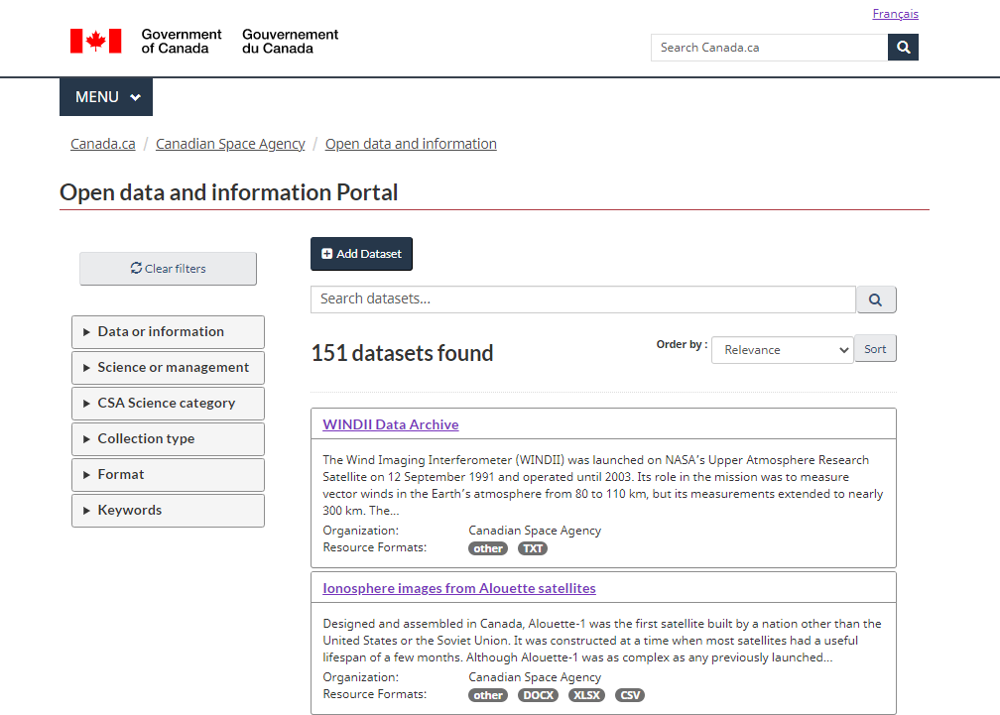
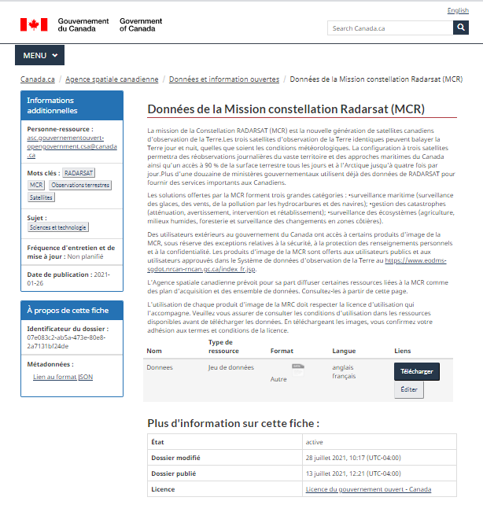

-----------------
ckanext-asc-csa (English follows)
-----------------
Cette extension CKAN permet l'implémentation du thème du gouvernement du Canada. Le site qui en résulte est entièrement
bilingue, accessible, et permet la visualisation des données dans le navigateur.

Vous pouvez accéder au portail en direct au https://donnees-data.asc-csa.gc.ca/fr/dataset.

Voulez-vous suggérer de nouvelles fonctionnalités ou de nouveaux ensembles de données ou signaler un bogue ? Créez une demande de problème `ici <https://github.com/asc-csa/ckanext-asc-csa/issues/new/>`_.

=============
Prérequis
=============

Cette version de l'extension est compatible avec CKAN 2.9. Les versions précédentes (0.1-0.4) étaient compatibles avec CKAN 2.8.

Cette extension requiert l'extension `ckanext-asc-csa-scheming <https://github.com/asc-csa/ckanext-asc-csa-scheming/>`_
ainsi que `ckanext-fluent <https://github.com/ckan/ckanext-fluent>`_.

=============
Installation
=============

Pour des instructions d'installation, veuillez vous référer au `document instructions d'installation </installation%20guide/installation%20guide_fr.md>`_.

=========================================
Catalogue de données (CsaCatalogPlugin)
=========================================

``CsaCatalogPlugin`` est une sous-classe de ``CsaPlugin`` destinée au catalogue
de données interne. Activez ``csa_catalog`` **à la place de** ``csa`` dans
``ckan.plugins`` (jamais les deux). Il ajoute :

* un statut de gouvernance par jeu de données (nouveau champ ``governance_status``),
  affiché dans le panneau « À propos de cet enregistrement », modifiable par les
  utilisateurs autorisés à mettre à jour le jeu de données, et offert comme
  facette de recherche ;
* un onglet « Rapports » dans les pages d'administration, avec le rapport sur le
  statut des jeux de données en HTML ou CSV ;
* le lien « Télécharger les résultats de recherche » à côté des conseils de
  recherche lorsque `ckanext-search-export <https://github.com/TkTech/ckanext-search-export>`_
  est activé. Listez ``csa_catalog`` avant ``search_export`` dans ``ckan.plugins``.

Le code propre au catalogue se trouve dans ``ckanext/csa/catalog/`` et ses gabarits
dans ``ckanext/csa/catalog/templates/``; le module public ne les charge jamais.
Le schéma de jeu de données interne est ``ckanext.csa.catalog:ckan_dataset.json``.
Utilisez-le dans ``scheming.dataset_schemas`` à la place de
``ckanext.csa:ckan_dataset.json``. Il s'agit d'une copie du schéma public avec
les champs internes supplémentaires, actuellement ``governance_status``.
Les modifications du schéma public doivent aussi être reportées dans cette copie.

------------
ckanext-asc-csa (le français précède)
------------

This CKAN extension allows for the implementation of the Government of Canada theme. The resulting site is
bilingual, accessible, and allows for in-browser data visualization.

The live version of the site is available at https://donnees-data.asc-csa.gc.ca/dataset.

Want to suggest new features or datasets or report a bug? Create an issue request `here <https://github.com/asc-csa/ckanext-asc-csa/issues/new/>`_.

=============
Requirements
=============

This version of the extension is intended for CKAN 2.9. Earlier releases (0.1-0.4) were intended for CKAN 2.8.

This extension is intended to be used alongside `ckanext-asc-csa-scheming <https://github.com/asc-csa/ckanext-asc-csa-scheming/>`_
as well as `ckanext-fluent <https://github.com/ckan/ckanext-fluent>`_.

=============
Installation
=============

For full installation instructions, please refer to the `installation instructions document </installation%20guide/installation%20guide_en.md>`_.
=========================================
Data catalogue (CsaCatalogPlugin)
=========================================

``CsaCatalogPlugin`` subclasses ``CsaPlugin`` for the internal data catalogue.
Enable ``csa_catalog`` **instead of** ``csa`` in ``ckan.plugins`` (never both).
On top of the public theme it adds:

* a governance status per dataset (new ``governance_status`` field), shown in the
  "About this record" panel, changeable there by users who may update the
  dataset, and offered as a search facet;
* a "Reports" tab in the administration pages with the dataset status report as
  HTML or CSV;
* a "Download search results" link beside the search tips when
  `ckanext-search-export <https://github.com/TkTech/ckanext-search-export>`_ is
  enabled. List ``csa_catalog`` before ``search_export`` in ``ckan.plugins`` so
  the catalogue theme controls where the link appears, and configure the export
  plugin as described in its README.

Catalogue-specific code lives in ``ckanext/csa/catalog/`` and its templates in
``ckanext/csa/catalog/templates/``; the public plugin never loads them.
Use ``ckanext.csa.catalog:ckan_dataset.json`` in ``scheming.dataset_schemas``
instead of ``ckanext.csa:ckan_dataset.json`` for the internal dataset schema,
which copies the public schema and adds internal fields, currently
``governance_status``. Apply changes to the public schema to this copy as well.
